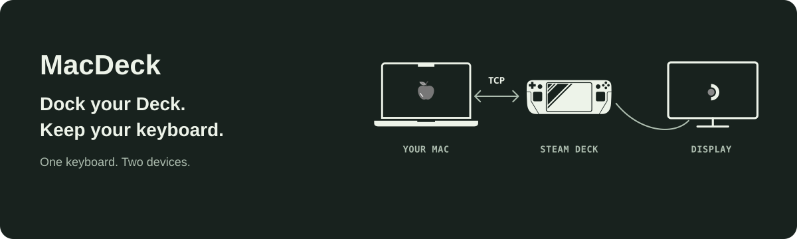

# MacDeck
Encrypted Mac keyboard and optional pointer input for Steam Deck Desktop Mode.

[Project website](https://macdeck.artembondar.dev/) · [Download](https://github.com/ArtemBondar/MacDeckInputBridge/releases/latest)



Send a Mac keyboard to a Steam Deck in Desktop Mode over your local network.
MacDeck captures physical key events on the Mac and creates a virtual keyboard
on the Deck. Optionally send your Mac trackpad or mouse along with the keyboard.
The connection is paired, authenticated, and encrypted.

Use it only on a trusted network. The pairing secret is a password for your
keyboard connection; do not share it or expose the Deck receiver to the
Internet.

## Install on Steam Deck

1. Switch to **Desktop Mode** and download
   `mac-deck-input-bridge-steamdeck-x86_64.tar.gz` from the
   [latest release](https://github.com/ArtemBondar/MacDeckInputBridge/releases).
2. In Konsole:

   ```sh
   cd ~/Downloads
   tar -xzf mac-deck-input-bridge-steamdeck-x86_64.tar.gz
   cd mac-deck-input-bridge-steamdeck-x86_64
   sh receiver/scripts/install-steamdeck-app.sh
   ```

3. Open **MacDeck** from the Desktop Mode application launcher.

When installing from a source checkout, the same install script automatically
builds the current checkout before copying the app.

## Steam library artwork

The app includes [Steam library artwork](docs/STEAM_LIBRARY_ART.md) for a local
Steam shortcut: icon, vertical card, horizontal header, and wide banner. Steam
requires manual artwork assignment for non-Steam shortcuts.

MacDeck needs access to Linux's virtual-input device. Run this once, then log
out of Desktop Mode and back in:

```sh
sudo steamos-readonly disable
sudo groupadd --system uinput
sudo usermod -aG uinput "$USER"
sudo tee /etc/udev/rules.d/99-mac-deck-input-bridge.rules >/dev/null <<'EOF'
KERNEL=="uinput", MODE="0660", GROUP="uinput", OPTIONS+="static_node=uinput"
EOF
sudo udevadm control --reload-rules
sudo udevadm trigger --subsystem-match=misc --action=change
sudo steamos-readonly enable
```

If the `uinput` group already exists, skip only the `groupadd` command.

## Install on macOS

1. Download and unzip `MacDeckInputBridge-macos.zip` from the same release.
2. Move `MacDeckInputBridge.app` to **Applications** and open it.
3. The current release is not notarized. On the first launch, choose **Done**
   in the warning. Open **System Settings → Privacy & Security**, scroll to
   **Open Anyway**, and confirm **Open**. Only do this for a file downloaded
   from this repository's release page.

   To open Privacy & Security directly, run in Terminal:

   ```sh
   open "x-apple.systempreferences:com.apple.preference.security?Privacy"
   ```
4. When macOS asks, allow **MacDeckInputBridge** in **Privacy & Security →
   Accessibility**. This is required to read and forward physical key events.

## Pair and use

1. In MacDeck on the Deck, open **Settings**, generate or copy the pairing
   secret, and note the displayed Deck IP address.
2. In the Mac menu-bar app, open **Settings** and enter that IP address and
   pairing secret.
3. In MacDeck's **Control** tab, choose **Enable Mac Input**.
4. On the Mac, choose **Send keyboard to Steam Deck** or press
   Control–Shift–F12. Press it again to return the keyboard to the Mac.

By default, the Mac stores the pairing secret in an owner-only local file,
outside app preferences and logs. In Settings, you can choose Keychain for
stronger protection; macOS may ask you to authorize access. An older Keychain
item may remain if you switch to local storage; remove it in Keychain Access
if you no longer need it.

## Keyboard layouts

MacDeck forwards physical keys, not typed characters. It works with any
keyboard layout, but the Mac and Deck need matching active layouts for letters
and symbols to produce the same text.

Enable **Sync active layout from Mac** in MacDeck's Settings to switch the
Deck layout automatically. MacDeck compares the Mac input-source identifier
with the layouts configured in **Plasma Settings → Keyboard → Layouts** and
switches only when there is one clear match.

For custom or ambiguous layouts, add a manual mapping in MacDeck. The value is
the zero-based order of the layout in Plasma, for example:

```text
com.apple.keylayout.US = 0
com.apple.keylayout.Ukrainian = 1
```

To get the value on the left, switch to that layout on the Mac, then open the
menu-bar app's **Settings…** and copy **Current Mac layout ID**.

If no match is found, key forwarding continues with the Deck's current layout.
MacDeck sends a layout update as soon as the secure connection is ready and on
each Mac input-source change. See [Keyboard layout synchronization](docs/KEYBOARD_LAYOUT_SYNC.md)
for matching rules and the custom-layout fallback.

## Pointer forwarding (experimental)

Use your Mac trackpad or mouse to move the Deck cursor, left/right click, drag,
and scroll in Desktop Mode. Pointer forwarding is off by default.

1. Install the Mac and Deck apps from the **same release**, then pair them as
   described above.
2. On the Mac, open MacDeck's **Settings**, select **Forward Mac pointer to
   Steam Deck**, and click **Save**.
3. Return input to the Mac if it is already being forwarded, then press
   **Control–Shift–F12** to reconnect. The shortcut now switches the keyboard
   and pointer together. On some Macs, hold **Fn** as well.
4. Move and click with your Mac trackpad or mouse. Press the shortcut again to
   return input to your Mac. To go back to keyboard-only use, clear the option,
   save, and reconnect.

MacDeck becomes the active Mac application while forwarding the pointer. If
another Mac application becomes active, forwarding stops and input returns to
the Mac. A connection failure also returns control to the Mac and releases held
keys and mouse buttons on the Deck.

Two-finger scrolling is sent to the Deck **and remains available on the Mac**.
Pinch and macOS system gestures stay on the Mac and are not forwarded. Pointer
forwarding targets Desktop Mode; Gaming Mode pointer support is not included.

If an older Deck app or an unavailable virtual mouse prevents pointer forwarding,
MacDeck reports it and keeps keyboard forwarding available. For troubleshooting,
check that both apps use the same release and the Deck's virtual-input permission
setup is complete.

## Clipboard sync (optional)

MacDeck can share new plain-text clipboard changes while the encrypted keyboard
connection is active. Each direction is off by default and requires consent on
both devices. For Mac → Deck, enable **Sync plain-text clipboard to Steam Deck**
on Mac and **Accept plain-text clipboard from Mac** on Deck. For Deck → Mac,
enable **Send plain-text clipboard to Mac** on Deck and **Accept plain-text
clipboard from Steam Deck** on Mac. Save both settings and reconnect.

Clipboard sync requires an active Steam Deck Desktop Mode Wayland session. It
does not run in Gaming Mode. It sends no existing clipboard when a connection
starts, no non-text formats, and no clipboard contents are logged or saved.
Clipboard text may contain sensitive information. Recent changes are coalesced
if they arrive faster than the connection can process them.

## Uninstall from Steam Deck

From the extracted Steam Deck release folder, run:

```sh
sh receiver/scripts/uninstall-steamdeck-app.sh
```

It removes MacDeck's launcher, binaries, and icons, but keeps pairing settings
for a future reinstall. To remove those too:

```sh
rm -rf ~/.config/mac-deck-input-bridge
```

## Privacy and limits

- No typed text is logged or stored.
- Optional clipboard sync is plain UTF-8 text only; it is encrypted in transit
  and clipboard contents are neither logged nor persisted.
- The receiver runs as your Deck user; it does not run as root.
- Keyboard forwarding is enabled by the shortcut; pointer forwarding is optional
  and off by default. There is no Bluetooth transport or remote video streaming.
- macOS-reserved shortcuts may remain handled by macOS.
